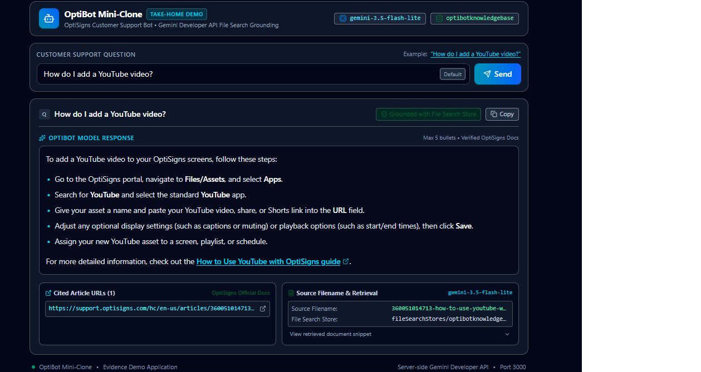

# OptiBot Mini-Clone

A small Python worker that fetches OptiSigns Zendesk Help Center articles, converts them to Markdown, indexes them in an existing Gemini File Search Store, and performs SHA-256 delta synchronization. The chatbot answers from the indexed documentation with Gemini grounding metadata.

## Setup

Requires Python 3.11+ and Docker for the container workflow.

```bash
python -m venv .venv
# Windows: .venv\Scripts\activate
pip install -r requirements.txt
copy .env.sample .env                 # use: cp .env.sample .env on macOS/Linux
python -m pytest -q
```

Configure `.env` locally (never commit it):

- `GEMINI_API_KEY`: Google Gemini Developer API key.
- `GEMINI_FILE_SEARCH_STORE_NAME`: full existing resource name, for example `fileSearchStores/...`.
- `SYNC_STATE_PATH`: optional path to a checkpoint manifest. Live deployments require durable storage; an unmounted local JSON file does not survive container replacement.

## Ingestion and demo

```bash
python -m app.scraper                         # fetch all Zendesk pages to data/articles/
python -m app.gemini_store upload-missing    # explicitly upload only missing article IDs
python -m app.gemini_chat demo               # one grounded YouTube-question demo
```

The repository includes **31 sample Markdown documents**, including the YouTube article used by the grounded demo. Each scheduled run follows every Zendesk API page and synchronizes the complete available corpus. Uploads and synchronization compare stable Zendesk article IDs and SHA-256 content hashes to avoid duplicates.

Gemini File Search performs managed chunking and retrieval; this project does not invent a second local chunking scheme. Markdown headings, lists, links, tables, images, and code blocks preserve useful semantic boundaries before upload. The demo was configured and tested through **Google AI Studio Build with File Search**, not the standard Playground conversation interface.



## Docker and daily synchronization

```bash
docker build -t optibot-sync:local .
docker run --rm optibot-sync:local --help
docker run --rm --env GEMINI_API_KEY --env GEMINI_FILE_SEARCH_STORE_NAME \
  --volume "$PWD/.sync-state:/state" optibot-sync:local \
  --dry-run --state-file /state/sync-state.json
```

With a verified checkpoint mounted at `/state/sync-state.json`, running the image without command arguments performs one full synchronization and exits with the worker status.

GitHub Actions runs the one-shot Docker worker daily at `02:17 UTC` (`09:17 Asia/Ho_Chi_Minh`). It restores the verified checkpoint from the dedicated `sync-state` branch and serializes runs. After the worker finishes, it persists verified article results and failure history even if some articles fail, then publishes a JSON report and step summary. Repository secrets provide the Gemini credentials.

Partial success is disabled by default. Set the repository variable `ALLOW_PARTIAL_SUCCESS=true` to permit at most one noncritical failed article, up to 1% of the processed articles, for fewer than two consecutive runs. The variables `MAX_FAILED_ARTICLES`, `MAX_FAILED_PERCENT`, and `MAX_CONSECUTIVE_FAILURES` adjust those limits. A failed checkpoint push or an upload whose remote outcome cannot be verified still fails the workflow.

- [Successful public workflow run (42370095789)](https://github.com/MinhT933/home-test-ai-minht933/actions/runs/42370095789): `added=0`, `updated=0`, `skipped=30`, `failed=0`, exit code `0`.
- [Daily sync and legacy bootstrap details](docs/daily-sync.md)
